# 👋 Hey, I'm Srijan

**Ruby on Rails Developer · Backend & Distributed Systems · Agentic AI Builder**

Rails engineer by trade. I build backend systems that hold up under real traffic, and AI tools that are actually useful.

**Jump to:** [🧭 At a glance](#-at-a-glance) · [🔭 Right now](#-what-im-doing-right-now) · [⭐ ATS Engine](#-ats-engine) · [🛠️ Projects](#️-projects) · [🧰 Stack](#-stack) · [📊 Stats](#-github-stats)

---

## 🧭 At a glance

| | |
|---|---|
| 💎 **What I do** | Ruby on Rails developer with 5+ years of production experience: Rails, PostgreSQL, Sidekiq, Kafka and Redis. Distributed systems, query performance, and breaking Rails monoliths into services without breaking production. |
| 🤖 **Agentic AI** | Building with the Claude Agent SDK and MCP, writing custom skills, and wiring LLMs into real workflows where the output has to be right, not just plausible. |
| 🧪 **Exploring** | Go for high-throughput services, and newer AI tooling: agent orchestration, evals, and MCP servers. |
| 🎓 **Background** | B.Tech, IIIT Jabalpur (2017–2021). Got into ML in college through computer vision and NLP projects, two of which reached national hackathon finals. |
| 📍 **Based in** | Bengaluru, India |

---

## 🔭 What I'm doing right now

- 🚀 **Shipped [ATS Engine](https://ats-engine-r2i1.onrender.com/)**: a resume-vs-JD scorer that explains every point and tells you what to fix first.
- 🤖 **Building with agents**: Claude Agent SDK, MCP servers, Claude Code skills, and agentic workflows for debugging, security audits and alerting.
- 🐹 **Go**: building small, fast services alongside Rails, for the workloads where throughput matters most.
- 🧪 **AI engineering**: agent orchestration, evals that catch regressions, and turning prompts into deterministic, testable pipelines.

---

## ⭐ ATS Engine

**Find out whether a typical ATS would filter your resume out, and exactly what to change first.** Upload a resume, paste a software engineering job description (entry or senior level), and get a score out of 100. Every point is explained, and the fixes are ranked by how much each one would actually raise your score.

```mermaid
flowchart LR
    in["Resume + JD"]:::you --> l0["L0 Parse<br/>PDF / DOCX / TXT<br/>hidden-text check"]:::step
    l0 --> llm["Claude<br/>structured extraction<br/>+ rubric judging"]:::ai
    llm --> l1["L1 Required criteria<br/>knockouts"]:::step
    l1 --> l2["L2 Skill gate"]:::step
    l2 --> l3["L3 Fit<br/>8 weighted dimensions"]:::step
    l3 --> l4["L4 Integrity<br/>stuffing, copy-paste,<br/>timeline conflicts"]:::step
    l4 --> out["Score + band<br/>+ ranked fixes"]:::out

    classDef you fill:#132a1f,stroke:#4ade80,color:#dcfce7
    classDef step fill:#0f2a3d,stroke:#38bdf8,color:#e0f2fe
    classDef ai fill:#1e1b3a,stroke:#a78bfa,color:#ede9fe
    classDef out fill:#3a2a0f,stroke:#fbbf24,color:#fef3c7
```

- 🧮 **Claude extracts, Python scores.** The LLM turns text into structured JSON and quotes evidence; all arithmetic is deterministic, and calls are cached by input hash, so the same input always gets the same score.
- ✅ **Honest fixes.** Each fix's gain comes from rescoring with that gap closed, and it never suggests adding skills you don't have.
- 🔒 **Privacy first.** Resumes are processed in memory, never written to disk or logged. Name, gender, age, photo and address never feed the score.
- 🛡️ **Production-hardened.** Per-IP rate limits, input caps, magic-byte upload checks, CSP and HSTS, request IDs, and health checks.

**Stack:** Flask (Python 3.13) · React 18 (Vite) · Claude API · Docker · GitHub Actions → GHCR · Render / Fly.io

---

## 🛠️ Projects

### 🤖 AI & NLP

| Project | What it does | Stack |
|---|---|---|
| **[ATS Engine](https://github.com/srijansingh53/ATS-Engine)** | Resume-vs-JD ATS scorer with explainable points and gain-ranked fixes. | Flask · React · Claude API · Docker |
| **[atithi](https://github.com/srijansingh53/atithi)** | WhatsApp conversational assistant for tourism in India. **Smart India Hackathon 2020 finalist** ([writeup](https://medium.com/mindmeld/conversational-ai-at-smart-india-hackathon-2020-1793dfa0b574#SIH2020)). | MindMeld · Elasticsearch · Twilio · Azure |
| **[hatErase](https://github.com/srijansingh53/hatErase)** | Tracks hate speech on Twitter in real time with an NLP classifier and emails you when a tracked handle posts. | Django · NLTK · Twitter API · AWS |
| **[Spam Identifier](https://github.com/srijansingh53/Spam-Identifier-Website)** | Spam/ham message classifier served as a web app. | Multinomial NB · scikit-learn · Node.js |
| **[Twitter Sentiment Analysis](https://github.com/srijansingh53/Twitter-Sentiment-Analysis)** | Sentiment classification for an Analytics Vidhya challenge (top 50 on the leaderboard). | Python · NLP |

### 👁️ Computer vision

| Project | What it does | Stack |
|---|---|---|
| **[FORID](https://github.com/srijansingh53/FORID-Build-4-India)** | Field-orbiting robot that maps crop disease, with an Android app. Google Build for Digital India regionals. | Raspberry Pi · Keras · OpenCV · Flask |
| **[CXR Segmentation](https://github.com/srijansingh53/Semantic-Segemtation-of-CXR)** | Lung-field segmentation in chest X-rays with U-Net. | Keras · OpenCV |
| **[MammoHance](https://github.com/srijansingh53/MammoHance)** | Implementation of an adaptive mammographic image-enhancement paper, to make micro-calcifications easier to spot. | OpenCV · scikit-image |
| **[Neuralifer](https://github.com/srijansingh53/Neural-Style-Transfer)** | Neural style transfer for artistic image generation. | Keras · OpenCV |

### 🌐 Web & backend

| Project | What it does | Stack |
|---|---|---|
| **[traXee](https://github.com/srijansingh53/traxee)** | Tracks e-commerce price movements with async workers and alerts. | Django · Celery · Redis · AWS |
| **[Portfolio](https://github.com/srijansingh53/srijansingh53.github.io)** | My personal site. | Gatsby · React |

---

## 🧰 Stack

---

## 📊 GitHub Stats

  
  

  

---

## 🤝 Say hi

Happy to talk Rails, backend systems, agentic AI, and side projects. Open an issue on a repo, or reach out on [LinkedIn](https://linkedin.com/in/srijan-singh-67538214a) or by [email](mailto:srijansingh53@gmail.com).

💎 Rails | ⚙️ Backend | 🤖 Agentic AI | 🐹 Go

